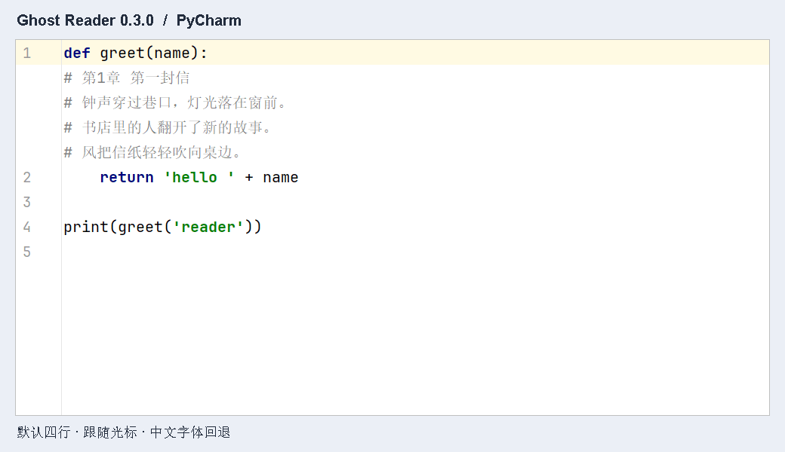

# Ghost Reader · Local TXT Reader for Your IDE

[简体中文](README.md) | **English**

Read a few lines of a local novel between coding sessions. Ghost Reader renders TXT content as virtual comments in the PyCharm editor, with pagination, chapter navigation, caret following, configurable shortcuts, and per-book progress.

**Version 0.3.0** · Kotlin / IntelliJ Platform · Local reading · MIT



> The GIF is generated from the real PyCharm editor component and plugin renderer. It demonstrates paging, chapter navigation, page height, caret following, and hide/show. It is a rendered demonstration, not a screen recording. The sample story is original test content.

## Features

- **Configurable page size:** 1–20 lines per page; 20–160 display columns. Defaults: 4 lines and 72 columns; common CJK characters take approximately two columns.
- **Record your own shortcuts:** click a shortcut field in plugin settings and press a combination. Clear bindings or restore defaults.
- **Start at a chapter:** load the chapter list, choose a heading, and apply settings. Leaving “Continue previous progress” selected preserves your position.
- **Follow the caret:** render below the current caret line, or select a fixed line and indentation.
- **Per-book progress:** resume after switching books or a normal IDE restart.
- **CJK font fallback:** use installed system fonts when the code font lacks a glyph.
- **Skip blank paragraphs:** empty lines and lines containing only spaces, tabs, or full-width spaces do not consume reading lines.
- **Hide/show:** remove both the text and its layout space, restoring regular editor navigation.

The reading text is an editor decoration. It does not enter source files, copied source code, formatting, undo history, or Git diffs. It remains visible on screen and in screenshots.

## Install

1. Download `ghost-reader-0.3.0.zip` from [Releases](https://github.com/lsm19870508/ghost-reader/releases), or build it from source below.
2. Open **Settings → Plugins → ⚙ → Install Plugin from Disk** in PyCharm.
3. Choose the plugin ZIP and restart when prompted. The source-code ZIP is not an installable plugin.

Install over version 0.1.0 / 0.2.0 to upgrade. The plugin ID is unchanged, preserving the saved book path and progress.

## Quick start

1. Open a project and a normal code file.
2. Choose **Tools → 小说隐形阅读器 / Ghost Reader → 配置小说路径与显示位置…** (configure book and display).
3. Browse for a local TXT. Set encoding, lines per page, and line width.
4. To choose a starting chapter, click **读取章节目录** (load chapters), then choose a heading in **从哪一章开始** (start chapter). Keep **继续上次进度** to resume.
5. Enable **显示阅读内容** (show reading content) and apply settings.
6. Focus the code editor and use the shortcuts below. Try `samples/demo.txt` first.

The settings UI currently uses Chinese labels; this guide provides their English equivalents.

## Default shortcuts

| Action | Windows / Linux default |
| --- | --- |
| Next page | `Ctrl + Right` |
| Previous page | `Ctrl + Left` |
| Next chapter | `Ctrl + Shift + Right` |
| Start of previous chapter | `Ctrl + Shift + Left` |
| Hide / show | `Ctrl + Alt + Shift + H` |
| Enable caret following | `Ctrl + Alt + Shift + A` |
| Open settings | `Ctrl + Alt + Shift + O` |

Click a shortcut field and press a new combination. Press `Backspace` alone to clear it. Use Ctrl, Alt, Meta, or a function key. Duplicate bindings are rejected. **恢复默认快捷键** restores defaults.

Bindings are scoped to the active code editor and do not rewrite your Keymap files. Paging/chapter bindings take precedence only while the reader is visible. Hiding restores normal editing; changing a default arrow binding releases its original editor navigation. Hide/show and settings shortcuts remain available in the code editor. All actions are also accessible from the Tools menu.

## Chapters, encoding, and progress

- Chapter detection recognizes standalone common Chinese numbered headings, prologues and epilogues, as well as `Chapter 1` and `Chapter IV`. The list displays sequential indexes and titles. Unusual formatting may produce missed or false headings.
- Previous chapter jumps to the preceding chapter's beginning. Next chapter advances to the next heading. Missing headings or a missing next chapter leave the current page unchanged.
- Selecting a chapter applies a one-time jump. Later reading continues to save normally; opening the IDE does not repeatedly reset to that chapter.
- `AUTO` handles UTF-8 and BOM-marked UTF-16. Choose `GB18030` for common GBK files. Invalid encodings produce an error instead of silent replacement characters.
- Settings and offsets live in `options/ghost-reader.xml` under the IDE configuration directory. They contain book paths and preferences, never the novel text, and are excluded from project files and Settings Sync roaming.
- The platform saves settings periodically and on normal exit. Abrupt shutdown may lose recent unsaved progress. Resizing pages preserves the approximate text position.

## Compatibility and limits

- Built and automatically tested on **PyCharm 2025.3.3 / build 253.31033.139 / JBR 21**, with 25 passing tests.
- Declared range: **253–262.\*** (PyCharm 2025.3–2026.2); other branches have not all been tested. No Python PSI or paid-feature dependency.
- Intended for local normal code editors. Remote Development, notebooks, diff views, and terminals are not specifically supported.
- Maximum TXT size: **16 MiB**. Use **重新读取 TXT** (reload TXT) after external modifications. Major edits or encoding changes permit only approximate offset recovery.
- Projects in one IDE share book preferences, progress, and visibility. Each project shows one decoration in its selected text editor.
- The block scrolls with code. Wrapping uses estimated character columns rather than automatic viewport reflow. Installed fonts must provide the required glyphs.

## Build from source

Use **JDK 21**, including the `jbr` bundled with a matching PyCharm installation. Initial builds require internet access for Gradle and dependencies.

```powershell
# Windows, with a local PyCharm SDK
.\build.ps1 -IdePath 'C:\Program Files\JetBrains\PyCharm 2025.3.3'

# Run an isolated development IDE
.\build.ps1 -IdePath 'C:\Program Files\JetBrains\PyCharm 2025.3.3' -RunIde
```

Alternatively set `JAVA_HOME` to JDK 21 and run:

```shell
# Use gradlew.bat on Windows; chmod +x gradlew on macOS / Linux
./gradlew test buildPlugin
```

Without `localIdePath`, Gradle downloads PyCharm 2025.3.3. The installable ZIP is `build/distributions/ghost-reader-0.3.0.zip`.

Versions: Gradle 9.5.0, Kotlin 2.4.21, IntelliJ Platform Gradle Plugin 2.20.0. Output targets JVM 21 and Kotlin language/API 2.2. Tests cover paging, encodings, chapters, configurable lines, shortcut rebinding, chapter selection, CJK painting, and unchanged document text/modification stamps.

## Contributing and license

Report issues with the PyCharm version, plugin version, encoding, and reproduction steps. Use a short original text sample when one is needed.

Licensed under [MIT](LICENSE). See [CHANGELOG.md](CHANGELOG.md) for release history.
