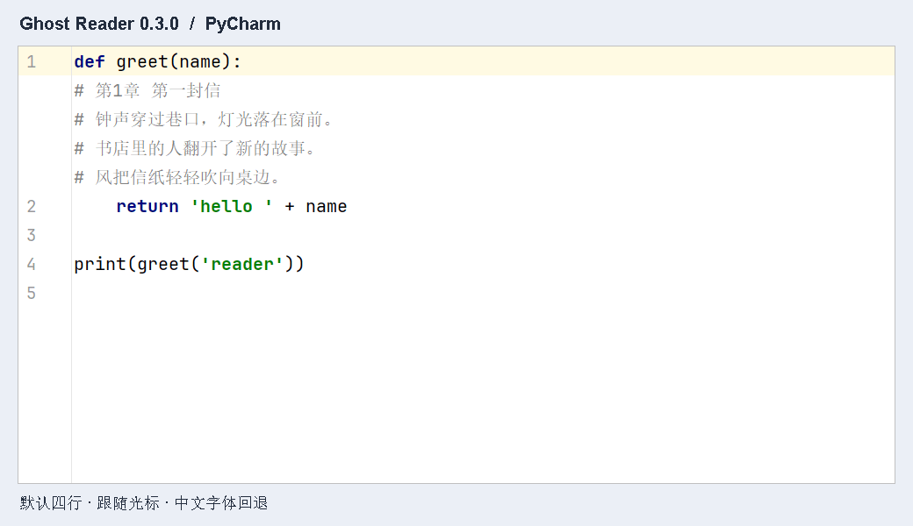

# Ghost Reader · IDE 小说隐形阅读器

**简体中文** | [English](README.en.md)

在 PyCharm 写代码的间隙，读几行本地小说。Ghost Reader 把 TXT 内容绘制成编辑器中的虚拟注释，支持分页、切换章节、跟随光标和一键隐藏，并记住每本书的阅读位置。

**当前版本：0.3.0** · Kotlin / IntelliJ Platform · 完全本地读取 · MIT



> 演示 GIF 由真实 PyCharm 编辑器组件及插件渲染器生成，展示翻页、章节切换、调整行数、跟随光标和隐藏显示；不是屏幕录制。示例小说为原创测试文本。

## 能做什么

- **行数和宽度可调**：每页 1–20 行，行宽 20–160 格；中文通常占两格，默认 4 行 × 72 格。
- **快捷键自己定**：在插件设置中点击输入框，直接按组合键；支持清除和恢复默认。
- **选章节开始读**：加载 TXT 的章节目录，选择希望开始的章节，点击“应用 / 确定”即可。
- **跟随光标**：显示在当前光标行下方，也可以改成固定行号并设置缩进。
- **自动记进度**：按书籍分别保存，切换小说或正常重启 IDE 后可以继续读。
- **中文字体回退**：代码字体缺少中文字形时，使用系统中的字体补齐。
- **跳过空白行**：空行、纯空格、制表符和全角空格行不占阅读行数。
- **一键隐藏**：移除阅读内容和占用的视觉空间，恢复原有编辑导航。

小说文字只存在于编辑器装饰中，不会进入代码文件、代码复制结果、格式化、撤销记录或 Git diff。“隐形”指不写入源文件，屏幕和截图里仍能看到它。

## 安装

1. 从仓库的 [Releases](https://github.com/lsm19870508/ghost-reader/releases) 下载 `ghost-reader-0.3.0.zip`，或者按下方说明从源码构建。
2. PyCharm → **设置 / Settings → 插件 / Plugins → ⚙ → 从磁盘安装插件 / Install Plugin from Disk**。
3. 选择插件 ZIP，按 IDE 提示重启。不要选择源码 ZIP。

已有 0.1.0 / 0.2.0 时可直接覆盖升级，插件 ID 不变，继续使用原来的小说路径和阅读进度。

## 第一次使用

1. 打开项目和一个普通代码文件。
2. 打开 **工具 / Tools → 小说隐形阅读器 / Ghost Reader → 配置小说路径与显示位置…**。
3. 浏览选择本地 TXT，设置编码、每页行数和行宽。
4. 想从某章开始：点击 **读取章节目录**，在 **从哪一章开始** 中选择章节；保留 **继续上次进度** 则不重置已有进度。
5. 勾选 **显示阅读内容**，点击 **应用 / 确定**。
6. 点击代码编辑器，使用下面的快捷键阅读。首次体验可使用 `samples/demo.txt`。

## 默认快捷键

| 操作 | Windows / Linux 默认组合键 |
| --- | --- |
| 下一页 | `Ctrl + →` |
| 上一页 | `Ctrl + ←` |
| 下一章 | `Ctrl + Shift + →` |
| 上一章开头 | `Ctrl + Shift + ←` |
| 隐藏 / 显示 | `Ctrl + Alt + Shift + H` |
| 开启跟随光标 | `Ctrl + Alt + Shift + A` |
| 打开设置 | `Ctrl + Alt + Shift + O` |

在插件设置中点击对应输入框，再按新的组合键；单独按 `Backspace` 清除。组合键需要包含 Ctrl、Alt、Meta，或使用功能键。重复组合键会被提示纠正；点击 **恢复默认快捷键** 可还原。

快捷键作用于当前代码编辑器，不修改用户的 Keymap 文件。翻页和章节键只在小说显示时接管，隐藏后恢复编辑功能。把默认方向键改成其他组合后，原方向键恢复编辑导航。隐藏 / 显示和设置入口在代码编辑器中仍可使用；所有操作也有工具菜单入口。

## 章节、编码与阅读进度

- **章节识别**：支持独占一行的 `第1章`、`第一百章`、`第１２章`、卷 / 回 / 节、序章 / 楔子 / 尾声 / 番外，以及 `Chapter 1`、`Chapter IV` 等常见标题。目录按出现顺序显示序号与标题。
- **章节跳转**：上一章会到前一章开头；下一章会到下一个标题。无可识别标题或没有下一章时保持当前页。特殊排版可能漏识别或误识别。
- **起始章节**：选择章节只在本次应用设置时跳转，之后仍按正常阅读进度保存，不会每次打开都重置到该章。
- **编码**：`AUTO` 支持 UTF-8 和带 BOM 的 UTF-16；常见 GBK 小说可选 `GB18030`。编码不匹配会提示，不会静默替换乱码。
- **保存位置**：IDE 配置目录的 `options/ghost-reader.xml`，包含书籍路径、阅读偏移量和插件设置，不保存小说正文，不写入项目，也不参与 Settings Sync 漫游。
- **保存时机**：跟随 IDE 自动保存设置及正常退出落盘，异常断电可能丢失最近尚未保存的少量进度。调整行数 / 宽度时尽量保留原来的文字位置。

## 兼容性与当前边界

- 实际构建与自动测试平台：**PyCharm 2025.3.3 / build 253.31033.139 / JBR 21**；25 项自动测试通过。
- 插件声明范围为 **253–262.\***（PyCharm 2025.3–2026.2），其他分支未逐一实测。不依赖 Python PSI 或付费功能。
- 适用于本地普通代码编辑器；Remote Development、Notebook、Diff 和终端未专门适配。
- 单个 TXT 最大 **16 MiB**。外部修改小说后，请使用菜单 **重新读取 TXT**；大幅改写或改编码后，旧偏移量只能就近恢复。
- 同一 IDE 的项目共享书籍、进度及开关，每个项目只在当前选中的文本编辑器里显示。
- 显示区域跟着代码滚动，行宽按字符格数估算，不随窗口宽度自动重排；系统需要有可显示中文的字体。

## 从源码构建

需要 **JDK 21**（可以用 PyCharm 安装目录中的 `jbr`）。首次构建需要联网下载 Gradle 和依赖。

```powershell
# Windows：使用本地 PyCharm 安装作为 SDK
.\build.ps1 -IdePath 'C:\Program Files\JetBrains\PyCharm 2025.3.3'

# 启动隔离的开发实例
.\build.ps1 -IdePath 'C:\Program Files\JetBrains\PyCharm 2025.3.3' -RunIde
```

也可设置 `JAVA_HOME` 为 JDK 21，直接执行：

```shell
# Windows 使用 gradlew.bat；macOS / Linux 先 chmod +x gradlew
./gradlew test buildPlugin
```

不指定本地 SDK 时，Gradle 会下载固定的 PyCharm 2025.3.3。产物位于 `build/distributions/ghost-reader-0.3.0.zip`。

使用 Gradle 9.5.0、Kotlin 2.4.21、IntelliJ Platform Gradle Plugin 2.20.0；输出 JVM 21 字节码，Kotlin API / 语言级别 2.2。测试覆盖分页、编码、章节、可配置行数、快捷键重绑定、章节选择、中文绘制以及源文档文字 / 修改戳不变。

## 参与与许可

欢迎通过 Issue 反馈问题。请提供 PyCharm 版本、插件版本、编码和复现步骤；需要样例时，请使用自行编写的短文本。

源代码使用 [MIT License](LICENSE)，更新记录见 [CHANGELOG.md](CHANGELOG.md)。
